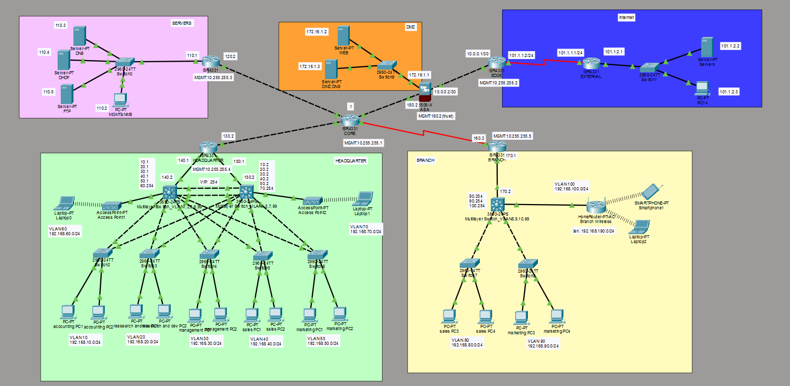

# Enterprise Network Design & Implementation

A comprehensive enterprise network simulation built with **Cisco Packet Tracer**, featuring multi-site architecture, security zones, redundancy, and centralized management.

---

## 📋 Project Overview

This project simulates a full-scale enterprise network environment covering headquarters, branch office, server cluster, DMZ, and external internet zones. It demonstrates real-world network design principles including redundancy, segmentation, security, remote management, and monitoring.

---

## 🗺️ Network Topology



```
                        ┌─────────────┐
                        │   Internet  │
                        │  101.1.x.x  │
                        └──────┬──────┘
                               │
                        ┌──────┴──────┐
                        │ EXT Router  │
                        │  101.1.1.2  │
                        └──────┬──────┘
                               │ NAT/PAT
                        ┌──────┴──────┐
                        │  ASA 5506   │
                        │  Firewall   │
                        └──┬──────┬───┘
                 trust      │      │ untrust
          ┌────────────────┘      └──────────────┐
          │                                       │
   ┌──────┴──────┐                        ┌───────┴──────┐
   │ CORE Router │                        │     DMZ      │
   │192.168.180.x│                        │ 172.16.1.0/24│
   └──┬──┬──┬───┘                        │  Web + DNS   │
      │  │  │                            └──────────────┘
   ┌──┘  │  └──────────────┐
   │     │                 │
┌──┴──┐ ┌┴────┐      ┌────┴────┐
│ HQ  │ │Svr  │      │ Branch  │
│     │ │Clstr│      │ Router  │
└──┬──┘ └─────┘      └────┬────┘
   │                      │
┌──┴──────────┐    ┌──────┴──────┐
│  L3 SW1+SW2 │    │   L3 SW3   │
│  (HSRP)     │    │  (Branch)  │
└─────────────┘    └────────────┘
```

---

## 🏗️ Network Zones

| Zone | Subnet | Description |
|------|--------|-------------|
| Server Cluster | 192.168.110.0/24 | DNS, DHCP, FTP, NMS |
| DMZ | 172.16.1.0/24 | Web Server, External DNS |
| HQ VLANs | 192.168.10-70.0/24 | Departments |
| Branch VLANs | 192.168.80-100.0/24 | Branch Departments |
| Management | 192.168.99.0/24 (HQ), 192.168.98.0/24 (Branch) | MGMT VLAN 999 |
| External | 101.1.1.0/24 | Internet Simulation |
| ASA-EXT Link | 10.0.0.0/30 | ASA to EXT Router |

---

## 🔀 VLAN Design

| VLAN ID | Name | Subnet | Location |
|---------|------|--------|----------|
| 10 | Accounting | 192.168.10.0/24 | HQ |
| 20 | Research & Dev | 192.168.20.0/24 | HQ |
| 30 | Management | 192.168.30.0/24 | HQ |
| 40 | Sales | 192.168.40.0/24 | HQ |
| 50 | Marketing | 192.168.50.0/24 | HQ |
| 60 | AP1 | 192.168.60.0/24 | HQ |
| 70 | AP2 | 192.168.70.0/24 | HQ |
| 80 | Sales | 192.168.80.0/24 | Branch |
| 90 | Marketing | 192.168.90.0/24 | Branch |
| 100 | Wireless | 192.168.100.0/24 | Branch |
| 999 | MGMT | 192.168.99.0/24 (HQ) / 192.168.98.0/24 (Branch) | All |

---

## ⚙️ Features Implemented

### 1. HSRP (Hot Standby Router Protocol)
Dual Layer 3 switches at HQ configured with HSRP for gateway redundancy. Each VLAN has an active/standby pair ensuring zero downtime if one switch fails.

```
! Example - VLAN 10 on SW1 (Active)
interface vlan 10
 ip address 192.168.10.1 255.255.255.0
 standby 10 ip 192.168.10.254
 standby 10 priority 110
 standby 10 preempt
 standby 10 track g1/0/1

! Example - VLAN 10 on SW2 (Standby)
interface vlan 10
 ip address 192.168.10.3 255.255.255.0
 standby 10 ip 192.168.10.1
 standby 10 priority 100
```

### 2. EtherChannel
Configured between the two HQ Layer 3 switches to provide link aggregation and redundancy on the inter-switch uplinks.
  
```
interface range GigabitEthernet1/0/8 - 9
 channel-group 1 mode active
interface port-channel 1
 switchport mode trunk
```

### 3. OSPF Dynamic Routing
OSPF configured across all routers and Layer 3 switches for dynamic route propagation. Loopback interfaces used as stable router IDs.

```
router ospf 1
 network 192.168.0.0 0.0.255.255 area 0
 network 10.255.255.x 0.0.0.0 area 0
 default-information originate
```

### 4. NAT/PAT
Configured on EXT router. Dynamic PAT for outbound traffic, static NAT for inbound access to DMZ services.

```
! Dynamic PAT
ip nat pool DANNY 101.1.1.3 101.1.1.10 netmask 255.255.255.0
ip nat inside source list NAT_ACL pool DANNY overload

! Static NAT - Web Server (HTTP)
ip nat inside source static tcp 172.16.1.2 80 101.1.1.2 80

! Static NAT - DMZ DNS
ip nat inside source static udp 172.16.1.3 53 101.1.1.2 53

! Static NAT - VPN
ip nat inside source static tcp 10.0.0.2 443 101.1.1.2 443
```

### 5. ASA Firewall & ACL
Cisco ASA 5506 deployed as perimeter firewall with three security zones.

| Interface | Zone | Security Level | IP |
|-----------|------|---------------|-----|
| G1/1 | trust (Inside) | 100 | 192.168.180.2/24 |
| G1/2 | untrust (Outside) | 0 | 10.0.0.2/30 |
| G1/3 | DMZ | 50 | 172.16.1.1/24 |

```
! ACL - Allow external access to DMZ
access-list OUTSIDE extended permit tcp any host 172.16.1.2 eq 80
access-list OUTSIDE extended permit udp any host 172.16.1.3 eq 53
access-list OUTSIDE extended permit tcp any host 10.0.0.2 eq 443

! ACL - Prevent DMZ from accessing Inside
access-list DMZ_IN extended deny ip 172.16.1.0 255.255.255.0 192.168.0.0 255.255.0.0
access-list DMZ_IN extended permit ip any any

access-group OUTSIDE in interface untrust
access-group ALL_OUT out interface DMZ
```

### 6. DMZ Architecture
Web server and external-facing DNS server isolated in DMZ zone. Split DNS strategy implemented:

| DNS Server | Location | Record | Resolves To |
|-----------|----------|--------|-------------|
| Internal DNS | Server Cluster (192.168.110.3) | www.danny.com | 172.16.1.2 (DMZ Web) |
| External DNS | DMZ (172.16.1.3) | www.danny.com | 101.1.1.2 (Public IP) |

### 7. DHCP
Centralized DHCP server at 192.168.110.4 serving all VLANs via `ip helper-address` configured on each SVI.

```
! On each L3 switch SVI
interface vlan 10
 ip helper-address 192.168.110.4
```

### 8. DNS
- **Internal DNS (192.168.110.3)**: Resolves internal hostnames and www.danny.com to DMZ Web Server IP
- **External DNS (172.16.1.3)**: Resolves www.danny.com to public IP 101.1.1.2

### 9. STP (Spanning Tree Protocol)
STP verified across all Layer 2 switches to prevent bridging loops. Root bridge election confirmed on HQ distribution switches.

### 10. Port Security
Configured on Layer 2 access switches to restrict unauthorized device access. Each access port is limited to one MAC address using sticky learning. Violations trigger automatic port shutdown.

```
interface FastEthernet0/1
 switchport mode access
 switchport port-security
 switchport port-security maximum 1
 switchport port-security mac-address sticky
 switchport port-security violation shutdown
```

| Parameter | Value |
|-----------|-------|
| Maximum MAC addresses | 1 per port |
| MAC learning | Sticky (auto-learned) |
| Violation action | Shutdown |

Verify with:
```
show port-security interface FastEthernet0/1
show port-security address
```

### 11. Clientless VPN (SSL WebVPN)
Remote access VPN configured on ASA allowing external users to access internal web resources via browser without installing a client.

```
webvpn
 enable untrust

group-policy DANNY_POLICY internal
group-policy DANNY_POLICY attributes
 vpn-tunnel-protocol ssl-clientless

username danny password xiong123
username danny attributes
 vpn-group-policy DANNY_POLICY

tunnel-group DefaultWEBVPNGroup type remote-access
tunnel-group DefaultWEBVPNGroup general-attributes
 default-group-policy DANNY_POLICY
```

**Access**: `https://101.1.1.2` → Login → VPN Portal

### 12. SNMP Monitoring
SNMP v2c configured on CORE router. NMS PC at 192.168.110.2 uses MIB Browser for device monitoring.

```
snmp-server community public RO
snmp-server community private RW
```

Key OIDs monitored:
- `.1.3.6.1.2.1.1.1.0` — System Description
- `.1.3.6.1.2.1.1.3.0` — System Uptime
- `.1.3.6.1.2.1.1.5.0` — System Name

### 13. SSH Remote Management
SSH configured on all routers and ASA firewall. Loopback interfaces used as stable management endpoints.

| Device | Hostname | Management IP |
|--------|----------|--------------|
| Core Router | core | 10.255.255.1/32 |
| EXT Router | edge | 10.255.255.2/32 |
| Servers Router | servers | 10.255.255.3/32 |
| HQ Router | headquarter | 10.255.255.4/32 |
| Branch Router | branch | 10.255.255.5/32 |
| ASA Firewall | ASA | 192.168.180.2 (trust) |
| HQ L3 SW1 | SW1 | 192.168.99.1/24 (VLAN 999) |
| HQ L3 SW2 | SW2 | 192.168.99.2/24 (VLAN 999) |
| Branch L3 SW | SW3 | 192.168.98.1/24 (VLAN 999) |

```
! Router SSH config
ip domain-name xiong.com
crypto key generate rsa  ! 1024 bits
username admin privilege 15 secret xiong123
line vty 0 4
 transport input ssh
 login local

! ASA SSH config
aaa authentication ssh console LOCAL
ssh 192.168.110.0 255.255.255.0 trust
ssh timeout 10
```

### 14. Wireless (AP)
Two access points deployed at HQ connected to respective VLANs (60 and 70). WLC deployment attempted but limited by Packet Tracer cross-subnet CAPWAP discovery constraints.

Branch office uses HomeRouter-PT-AC (consumer-grade, not WLC-managed).

---

## 🔒 Security Design Principles

- **Defense in Depth**: ASA firewall + ACL + DMZ isolation + Port security
- **Least Privilege**: OUTSIDE ACL only permits necessary ports to DMZ
- **Zone Separation**: Inside (100) / DMZ (50) / Outside (0) security levels
- **Management Isolation**: Dedicated VLAN 999 for management traffic
- **Encrypted Management**: SSH only, Telnet disabled
- **Split DNS**: Internal and external users resolve to different IPs

---

## 📁 Project Structure

```
enterprise-network/
├── README.md
├── packet-tracer/
│   └── enterprise-network.pkt
└── docs/
    ├── topology-diagram.png
    └── ip-addressing-table.xlsx
```

---

## 🛠️ Tools Used

- **Cisco Packet Tracer** 8.x
- Cisco ISR 4331 Routers
- Cisco ASA 5506-X Firewall
- Cisco 3560-CPS Multilayer Switches
- Cisco 2960-24TT Layer 2 Switches
- Cisco AccessPoint-PT
- Cisco HomeRouter-PT-AC
---

## 📚 Concepts Demonstrated

| Concept | Technology |
|---------|-----------|
| Dynamic Routing | OSPF |
| Gateway Redundancy | HSRP |
| Link Aggregation | EtherChannel (LACP) |
| Network Segmentation | VLAN + SVI |
| Address Translation | NAT/PAT |
| Perimeter Security | ASA Firewall + ACL |
| Isolated Service Zone | DMZ |
| Remote Access | Clientless SSL VPN |
| Network Monitoring | SNMP v2c |
| Secure Management | SSH + Loopback |
| Loop Prevention | STP |
| Automatic IP Assignment | DHCP + Helper Address |
| Name Resolution | Split DNS |
| Port-level Access Control | Port Security |
---

## 🚀 Getting Started

1. Download and install [Cisco Packet Tracer](https://www.netacad.com/courses/packet-tracer)
2. Clone this repository
3. Open `packet-tracer/enterprise-network.pkt`
4. Explore the topology and configurations

---

## 📝 Notes

- Packet Tracer ASA 5506 has known simulation limitations (some commands not supported)
- WLC cross-subnet AP registration requires DHCP Option 43 which Packet Tracer does not support
- SNMP `snmp-server host` command not supported on some PT router models
- All passwords in this project are for lab use only — never use simple passwords in production

---

## 👤 Author

Built as a comprehensive networking lab exercise covering enterprise-grade network design, security, and management practices.

---

*Simulated environment — Cisco Packet Tracer*
